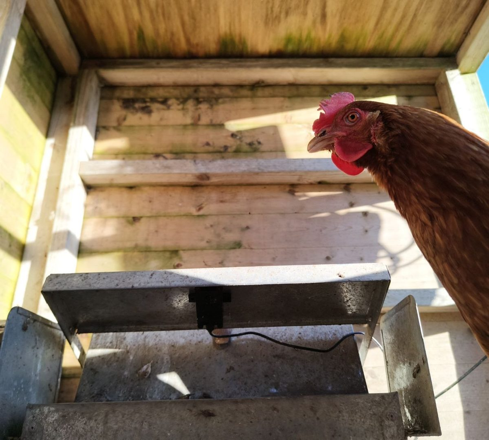
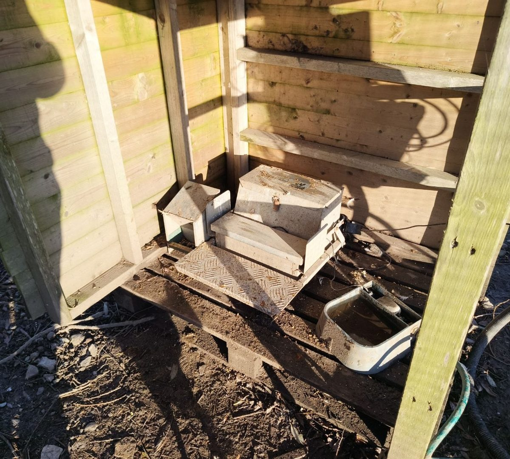
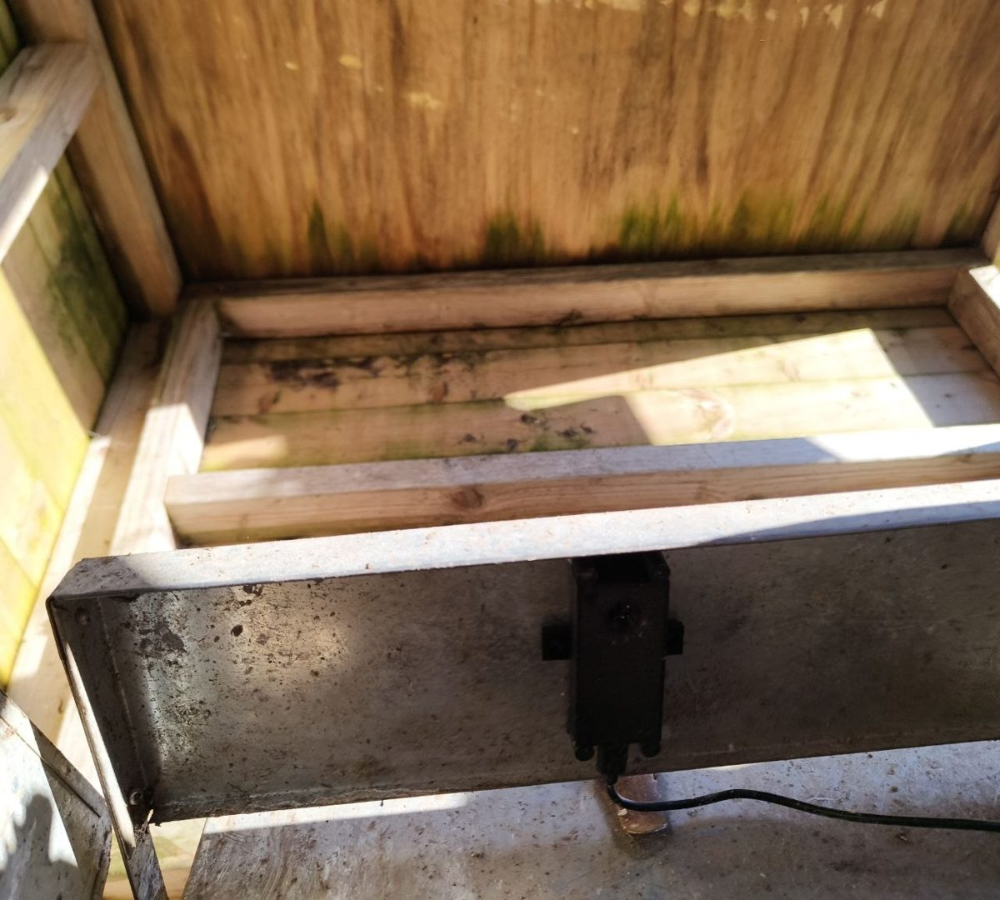
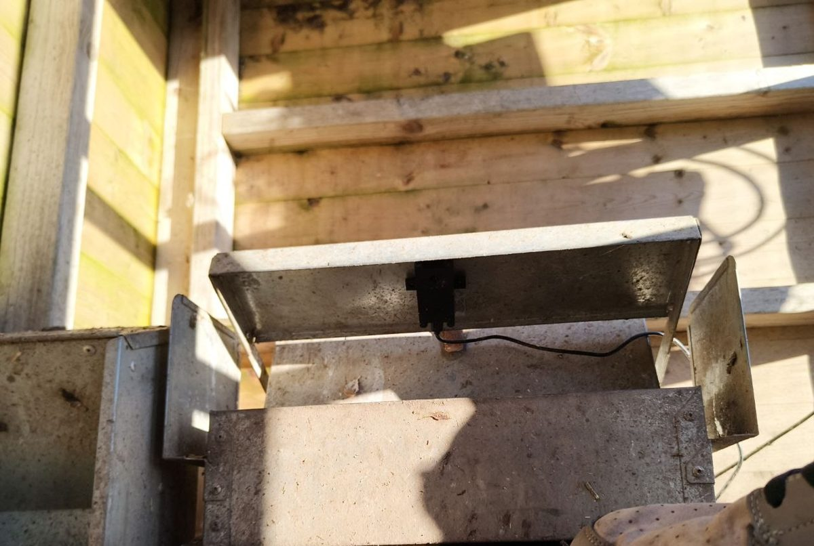
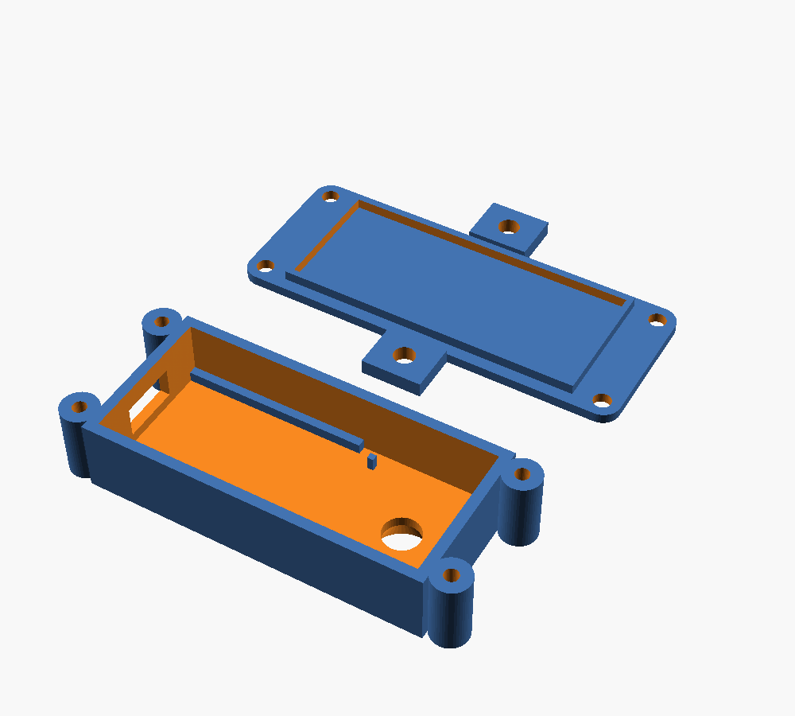
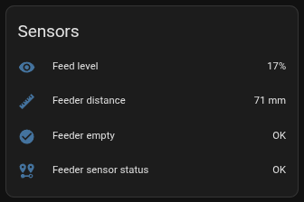
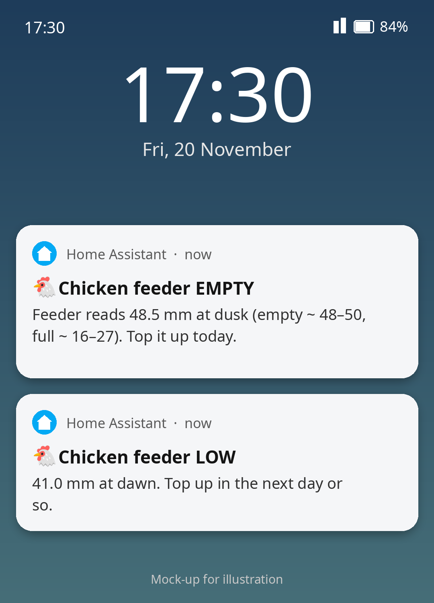

# Chicken feeder level sensor (ESPHome + Home Assistant)

Tells you when the chicken feeder is running low or empty. It's rough but it works: it has run on a real flock since November 2026. Released as-is in the hope that others will refine it.

| The feeder in its shelter | Sensor box under the hopper lid |
|---|---|
|  |  |

## How it works

- A **VL6180X time-of-flight sensor** mounts under the hopper lid and looks straight down at the feed.
- A **LOLIN ESP32-C3 Mini** running ESPHome reports the distance to Home Assistant.
- An HA package judges the level only at **quiet times** (17:30 and 06:30/08:00), when the birds aren't working the treadle flap, and sends a LOW or EMPTY alert.

## What it looks like in Home Assistant

Alerts arrive on your phone (mock-up; the wording comes from the HA package and can be customised):

## Hardware

| Part | Notes |
|---|---|
| LOLIN (Wemos) ESP32-C3 Mini | Wi-Fi TX is set to 8.5 dB because some v2.1 boards won't associate at full power |
| VL6180X breakout | I²C: SDA GPIO8, SCL GPIO10, 3V3, GND |
| Printed enclosure | `enclosure/` (OpenSCAD source + STLs). PETG or ASA. It screws or zip-ties to the underside of the hopper lid. The sensor window is open on purpose, because a cover causes ToF crosstalk |
| USB supply | Any decent 5 V USB supply; the C3 + VL6180X draws well under 1 A. Just don't share it with other kit (see below) |

Tested on a treadle feeder with a 9 kg hopper. Any covered hopper should work.

## Lessons learned (read these before calibrating)

- **Daytime readings are noise.** Birds lift the treadle flap, and the sensor then sees spikes of ~120–175 mm. The firmware runs a 3-minute median (36 × 5 s samples), but only the quiet-time readings are reliable.
- **Empty is closer than you'd think.** Feed cones and slumps, so an empty hopper read ~48–50 mm at quiet times rather than the full depth. Our first threshold (≥70 mm) never fired when the feeder really ran out.
- **For a trend graph, use one reading per night.** `sensor.chicken_feeder_nightly_level` takes the median of valid readings from 00:00 to 05:00 each day. In our data it climbs steadily (22 → 37 → 41 → 48 mm over four days), then drops on refill. Rolling 6 h medians and percentiles still wobbled by ±20 mm, because daytime readings are contaminated in both directions.
- Our numbers: **full ≈ 16–27 mm, low ≥ 40 mm, empty ≥ 46 mm.** Measure your own: log a full night after a refill, and a night when it's actually empty.
- "No Target" / "Out of Range" is treated as empty. If the box falls off the lid, the sensor sees the ground and gives a false "empty".
- **If it keeps dropping off Wi-Fi, suspect power first.** Our dropouts were brownouts: a 5 W water heater shared the C3's 1 A USB supply. Giving the heater enough headroom (we moved both onto a 2 A supply) fixed it. The sensor alone doesn't need 2 A. (Signal inside a galvanised feeder cage was fine at about −53 dBm.)

## Install

1. `esphome/`: copy `secrets.example.yaml` to `secrets.yaml` and fill it in. Set `FULL_MM` / `EMPTY_MM`, then flash.
2. `home-assistant/chicken_feeder.yaml`: drop it into your `packages/` folder. Replace `notify.YOUR_NOTIFIER` with your notify entity, and adjust the 40/46 mm thresholds and entity IDs if your device name differs.

The VL6180X component is [thedayowl/esphome-vl6180x](https://github.com/thedayowl/esphome-vl6180x), pinned to a reviewed commit.

## TODO / future version

**Goal: make it a genuinely low-power device** (battery or solar, no USB lead to the run).

Key point: the 5 s sampling only exists to beat daytime flap noise, and continuous sampling rules out deep sleep. Since only quiet-time readings are trustworthy anyway (birds roosting, flap still), a low-power version only needs to wake once or twice a day, take a short burst (say 10 samples in 10 s) and send the median.

- [ ] **Deep sleep** between readings. Today the C3 is always on Wi-Fi, sampling every 5 s and reporting every 30 s. Waking every 15–60 min (or only at the quiet-time windows) for a burst of samples, sending one median, then sleeping would cut consumption by orders of magnitude
- [ ] **Accelerometer wake-up** (e.g. LIS3DH/ADXL345 interrupt on a wake GPIO): wake and measure when the treadle/lid moves or after a refill, instead of on a timer
- [ ] Power down the VL6180X between bursts (its GPIO0/CE pin), and use a low-quiescent regulator
- [ ] Battery voltage reporting and a low-battery alert
- [ ] **Beeper/buzzer** at the feeder for a local low-feed warning
- [ ] Move the empty/low logic onto the device (quiet-time windows) so it works without HA
- [ ] Auto-calibration (learn full/empty from the readings after a refill)
- [ ] Enclosure v2: proper mounting ears and a cable gland
- [ ] Better handling of feed cone/slump, perhaps a wider-angle or multi-zone ToF sensor (e.g. VL53L5CX)

**Hardware roadmap**

- [ ] **Custom PCB**: ESP32-C3 + ToF + accelerometer + battery/charging on one board, sized for the enclosure
- [ ] **Commercial product**, if viable: a sealed, battery-powered unit that clips under any hopper lid
- [ ] **Market viability study**: who would buy it (backyard keepers, smallholders, farms), price point vs BOM, competing products, and channels (Home Assistant community, poultry suppliers)

## License

MIT. Use it, fork it, improve it.
